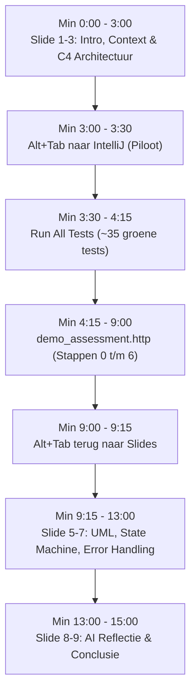

# 🎬 DRAAIBOEK & SCRIPT: MONDELING ASSESSMENT BRUL2
**Module:** INFD-AD-B AI-Powered Software Development (Periode 1, 2026-2027)  
**Onderdeel:** Eerste 15 Minuten (Live Demonstratie + UML & Architectuur)  
**Totaalduur Presentatie:** Maximaal 15:00 minuten (daarna 30 minuten individuele vragen)  
**Locatie:** Avans Hogeschool Breda / 's-Hertogenbosch  

---

## 📋 1. Checklist Vooraf (10 Minuten voor de Deur)

Zorg dat deze 6 punten geregeld zijn **voordat** jullie naar binnen lopen:

1. **Welke laptop sluit aan?**  
   Kies **één** laptop die aangesloten wordt op het Smartboard via HDMI/USB-C. (Tip: degene met het snelste systeem en werkende Ktor setup).
2. **Oplader & Scherminstellingen:**  
   - Laptop aan de netstroom hangen (voorkom batterijbesparing).
   - Schermresolutie instellen op **1920x1080 (100% schaling)** zodat IntelliJ en de slides scherp en groot leesbaar zijn voor de assessoren.
   - Windows meldingen op "Niet storen / Focus" zetten.
3. **De Applicatie alvast starten:**  
   - Open een terminal in `c:\Users\k.schouten\Documents\GitHub\Brul2`
   - Voer uit: `.\kotlin.bat run`
   - Controleer in de browser of `http://localhost:8080/api/v1/health` een `{"status":"ok"}` geeft.
4. **Presentatie openzetten:**  
   - Open [`docs/PRESENTATIE_ASSESSMENT.html`](file:///c:/Users/k.schouten/Documents/avans/avans_jaar2_periode1/PRESENTATIE_ASSESSMENT.html) in Chrome of Edge.
   - Druk op **`F11`** voor volledig scherm (Full-Screen).
5. **IntelliJ klaarzetten op het tweede scherm/tab:**  
   - Open het bestand [`demo_assessment.http`](file:///c:/Users/k.schouten/Documents/GitHub/Brul2/demo_assessment.http).
   - Zorg dat het projectvenster met de map `test/` zichtbaar is.
6. **Rollen verdelen:**
   - **De Piloot:** Degene achter de laptop. Deze raakt muis/toetsenbord aan, schakelt tussen slides en klikt in IntelliJ. *De piloot praat NIET tijdens het klikken.*
   - **De Sprekers:** Phuc, Maikel, Kelvin, Joselyn en Natasja doen om de beurt het woord.

---

## ⏱️ 2. Het Minuut-voor-Minuut Draaiboek (15:00 Min)

---

### DEEL 1: INTRODUCTIE & ARCHITECTUUR (Min 0:00 – 3:00)
*Visueel: Browser in Full-screen (`docs/PRESENTATIE_ASSESSMENT.html`)*

#### Minuut 0:00 – 1:00 | Slide 1: Titel & Teamverdeling
* **Actie Piloot:** Start de timer rechtsboven (klik op 'Start'). Slide 1 staat in beeld.
* **Spreker: Phuc**
  > *"Goedemorgen assessoren. Welkom bij het assessment van projectgroep BRUL. Voor Periode 1 hebben wij een robuuste, modulaire Web API ontwikkeld in Kotlin met behulp van het Ktor Framework.*  
  > *Op deze eerste slide ziet u onze teamverdeling: om Separation of Concerns te waarborgen, heeft ieder van ons de volledige eigenaarschap genomen over een eigen feature-package: ikzelf deed Identity en Authenticatie, Maikel Incidenten en Meldingen, Kelvin Hulpvragen en Vrijwilligersparticipatie, Joselyn het Voting-systeem en Natasja Gebruikersbeheer en RBAC. We laten u nu kort de context en onze architectuur zien."*

#### Minuut 1:00 – 2:00 | Slide 2: Probleem & Context (Klik $\rightarrow$)
* **Actie Piloot:** Druk op pijltje rechts ($\rightarrow$) naar Slide 2.
* **Spreker: Maikel**
  > *"Waarom BRUL? Veel traditionele buurt-apps fungeren helaas als online klaagmuren waar mensen alleen klagen over zwerfafval of geluidsoverlast. Met BRUL wilden we dat omdraaien: burgers kunnen niet alleen incidenten of veiligheidssituaties melden op een interactieve kaart, maar ook positieve actie ontketenen via hulpvragen. Denk aan een oudere buurtgenoot die hulp nodig heeft met zware boodschappen of een buurttuin-opruimactie. Via ons platform kunnen wijkbewoners zich met één klik aanmelden als vrijwilliger."*

#### Minuut 2:00 – 3:00 | Slide 3: Systeemarchitectuur & Lokale Persistentie (Klik $\rightarrow$)
* **Actie Piloot:** Druk op pijltje rechts ($\rightarrow$) naar Slide 3.
* **Spreker: Kelvin**
  > *"Om dit te realiseren hebben we gekozen voor Clean Architecture. Onze applicatie is strikt opgedeeld in lagen:*  
  > *1. De Transportlaag met Ktor 3 en Netty, voorzien van plugins voor ContentNegotiation, JWT Authenticatie en StatusPages.*  
  > *2. De Servicelaag waarin alle pure bedrijfsregels en validaties leven, losgekoppeld van HTTP-statussen.*  
  > *3. De Persistentielaag waarin we JetBrains Exposed gebruiken als type-veilige SQL DSL. Onze services communiceren exclusief via abstracte Repository interfaces conform het Dependency Inversion Principe.*  
  > *4. En tot slot de database: we gebruiken een ingebedde H2 SQL database die zijn data lokaal wegschrijft naar het bestand `data/brul.mv.db`. Voor onze unittests schakelt deze automatisch over naar een geïsoleerde in-memory instantie.*  
  > *Laten we direct naar IntelliJ overschakelen om te bewijzen dat dit werkt!"*

---

### DEEL 2: LIVE TESTSUITE & USER FLOW (Min 3:00 – 9:00)
*Visueel: Piloot drukt op `Alt + Tab` naar IntelliJ IDEA*

#### Minuut 3:00 – 4:15 | De Geautomatiseerde Testsuite
* **Actie Piloot:**
  1. Klik met de **rechtermuisknop** op de hoofdmap `test/` in het projectoverzicht.
  2. Klik op **"Run 'All Tests'"**.
  3. Wacht 10-15 seconden terwijl de balk groen volloopt met ~35 groene vinkjes.
* **Spreker: Natasja**
  > *"Voordat we de API handmatig demonstreren, laten we onze geautomatiseerde testsuite zien. U ziet hier ruim 35 unit- en integratietests voor al onze packages. De tests draaien tegen een H2 in-memory database met realistische seed-data en dekken zowel de happy flows, autorisatietests als edge-cases af. Alles is 100% groen."*

#### Minuut 4:15 – 9:00 | De End-to-End User Flow (`demo_assessment.http`)
* **Actie Piloot:** Open het bestand `demo_assessment.http`. Loop stapsgewijs langs de nummers.

##### Stap 0 & 1: Health & Login (Min 4:15 – 5:00)
* **Actie Piloot:** Klik op het groene pijltje bij **Stap 0** (`GET /health`), daarna **Stap 1a** (Login Anastasia) en **Stap 1b** (Login Bob).
* **Spreker: Phuc**
  > *"Stap 0 toont onze health check: status 'ok'.*  
  > *Bij Stap 1 loggen we in met twee wijkbewoners: Anastasia en Bob. Wachtwoorden worden geverifieerd tegen gehashte BCrypt-records. Ktor genereert direct een cryptografisch ondertekend JWT Bearer-token met claims voor hun rol en userId. Ons script slaat deze tokens automatisch op als globale variabelen."*

##### Stap 2: Melding & Hulpvraag plaatsen (Min 5:00 – 5:45)
* **Actie Piloot:** Klik op het groene pijltje bij **Stap 2** (`POST /reports` als Anastasia).
* **Spreker: Maikel**
  > *"Anastasia plaatst nu een nieuwe Hulpvraag: 'Boodschappenhulp gezocht'. Omdat ze slecht ter been is vraagt ze om 2 vrijwilligers. Het endpoint accepteert geografische coördinaten en valideert dat de categorie 'GROCERIES' is toegestaan voor een HelpRequest. De server retourneert HTTP 201 Created met het nieuwe ID."*

##### Stap 3: Vrijwilligersparticipatie & Capaciteit (Min 5:45 – 7:00)
* **Actie Piloot:** 
  1. Klik op **Stap 3a** (`GET /reports/{id}/participants`).
  2. Klik op **Stap 3b** (`POST /reports/{id}/participants` met `bobToken`).
  3. Klik op **Stap 3c** (`GET /reports/{id}/participants`).
  4. Klik op **Stap 3d** (`GET /reports/{id}/participants/list`).
* **Spreker: Kelvin (JOUW HOOGTEPUNT!)**
  > *"Nu komt mijn onderdeel in actie: features/help.*  
  > *Bij 3a roept Bob de publieke deelnamestatus op: volunteersNeeded is 2, participantCount is 0, en status is OPEN.*  
  > *Bij 3b besluit Bob te helpen: hij stuurt een POST met zijn JWT token. De service controleert of hij niet al meedoet en of er plek is, en Exposed schrijft een record in 'help_participations'.*  
  > *Als we bij 3c de status opnieuw opvragen, zien we direct dynamische state transition: participantCount is nu 1, availablePlaces is verlaagd naar 1, en de status blijft OPEN.*  
  > *Bij 3d zien we in de lijst dat Bob's ID netjes gekoppeld is."*

##### Stap 4: Negatieve Test & Domeinvalidatie (Min 7:00 – 7:45)
* **Actie Piloot:** Klik op het groene pijltje bij **Stap 4** (`POST /reports/{id}/participants` met `anastasiaToken`).
* **Spreker: Kelvin**
  > *"We demonstreren nu onze robuuste foutafhandeling met een negatieve test. Anastasia is de eigenaar van deze hulpvraag. Als zij zichzelf probeert in te schrijven als vrijwilliger, weigert onze service dit en gooit een HelpParticipationForbiddenException.*  
  > *Zoals u ziet in de response: Ktor StatusPages vangt dit centraal op en retourneert keurig HTTP 403 Forbidden met de JSON error 'You cannot join your own help request'. Geen crashes, maar nette defensieve validatie."*

##### Stap 5 & 6: Voting & Admin Moderatie (Min 7:45 – 9:00)
* **Actie Piloot:** Klik op **Stap 5a & 5b** (Bob stemt UP), daarna **Stap 6a & 6b** (Admin login en `/users` opvragen).
* **Sprekers: Joselyn & Natasja**
  > *Joselyn: "Bij stap 5 brengt Bob een UPVOTE uit. Onze vote-engine herrekent direct de score naar 1, waardoor deze hulpvraag hoger op de wijkfeed komt."*  
  > *Natasja: "Bij stap 6 logt de beheerder in met rol ADMIN. Via RBAC-autorisatie heeft alleen deze rol toegang tot het /users endpoint. Gewone gebruikers krijgen hier een 403 Forbidden."*

---

### DEEL 3: UML & ARCHITECTUURDIEPGANG (Min 9:00 – 13:00)
*Visueel: Piloot drukt op `Alt + Tab` terug naar de presentatie in Chrome*

#### Minuut 9:00 – 10:30 | Slide 5: Klassendiagram & Klassenrelaties (Klik $\rightarrow$)
* **Actie Piloot:** Navigeer naar Slide 5 ("Domeinontwerp & Klassenrelaties").
* **Sprekers: Maikel & Kelvin**
  > *Maikel: "Terug naar onze architectuur. In ons UML-klassendiagram ziet u de 3 klassenrelaties duidelijk terug. Allereerst Overerving: HelpRequest, SafetyReport en NuisanceReport erven over van de abstracte klasse Report. Dit voorkomt redundantie en maakt polymorfe queries mogelijk."*  
  > *Kelvin: "Daarnaast Compositie: Location is een Value Object dat onlosmakelijk verbonden is met een Report. En tot slot Associatie: HelpParticipation fungeert als de associatieve entiteit die een User en een HelpRequest aan elkaar koppelt."*

#### Minuut 10:30 – 12:00 | Slide 6: State Machine & Exposed Integriteit (Klik $\rightarrow$)
* **Actie Piloot:** Navigeer naar Slide 6 ("Toestandsmachine & Database-Integriteit").
* **Spreker: Kelvin**
  > *"Voor features/help hebben we twee niveaus van integriteit ingebouwd:*  
  > *1. Op serviceniveau: een State Machine. Een hulpvraag begint als OPEN. Zodra de capaciteit wordt bereikt door aanmeldingen, berekent een Kotlin 'when' expressie direct de toestand FULL. Sluit de beheerder de taak, dan wordt hij CLOSED.*  
  > *2. Op databaseniveau in Exposed: onze koppeltabel heeft een samengestelde unieke index op (helpRequestId, userId) zodat dubbele deelnames fysiek onmogelijk zijn. Bovendien zorgt ReferenceOption.CASCADE ervoor dat als een melding wordt gewist, alle deelnames automatisch mee worden opgeruimd."*

#### Minuut 12:00 – 13:00 | Slide 7: Centrale Error Handling (Klik $\rightarrow$)
* **Actie Piloot:** Navigeer naar Slide 7 ("Centrale Foutafhandeling").
* **Spreker: Natasja**
  > *"Hier ziet u onze filosofie rondom error handling. In plaats van vervuilende try-catches in elke route, gebruiken we de Ktor StatusPages plugin. De services gooien puur semantische Kotlin runtime exceptions. StatusPages mapt deze centraal naar een gestandaardiseerd ApiError DTO. Daardoor zijn onze routes extreem clean en leesbaar."*

---

### DEEL 4: AI VERANTWOORDING & OVERDRACHT (Min 13:00 – 15:00)

#### Minuut 13:00 – 14:15 | Slide 8: AI Verantwoording (Klik $\rightarrow$)
* **Actie Piloot:** Navigeer naar Slide 8 ("Verantwoording Inzet AI-Tooling").
* **Sprekers: Kelvin & Joselyn**
  > *Kelvin: "Conform de Avans leeruitkomsten hebben we gereflecteerd op ons AI-gebruik. Wij hanteerden het '2-sporen model': AI werd gebruikt als interactieve sparringpartner en examinator om randvoorwaarden en theorie te toetsen, nooit als blind kopieerapparaat.*  
  > *We kwamen er al snel achter dat AI vaak verouderde Java-patronen voorstelde, zoals omslachtige string-formatters in plaats van idiomatische Kotlin templates. Door alle code handmatig te toetsen en unittests te schrijven, hebben we gezorgd dat we elk onderdeel zelfstandig kunnen doorgronden en verdedigen."*

#### Minuut 14:15 – 15:00 | Slide 9: Conclusie & Vragenronde (Klik $\rightarrow$)
* **Actie Piloot:** Navigeer naar Slide 9 ("Klaar voor de Dieptevragen"). Stop de timer.
* **Spreker: Phuc / Iedereen**
  > *"Samenvattend: BRUL beschikt over een 100% groene testsuite, een schaalbare Clean Architecture met Ktor en Exposed, en lokale persistente opslag. De backend is volledig gereed om in Periode 2 verbonden te worden met onze native Android Jetpack Compose app.*  
  > *Wij danken u voor uw aandacht en kijken uit naar uw individuele vragen!"*

---

## 🚨 3. Noodplan (Wat als er iets tegenzit?)

* **Situatie A: Poort 8080 is al bezet (Port already in use error)**  
  *Oplossing:* Open PowerShell en typ:  
  `Get-Process -Id (Get-NetTCPConnection -LocalPort 8080).OwningProcess | Stop-Process -Force`  
  Start daarna direct opnieuw met `.\kotlin.bat run`.
* **Situatie B: H2 database is gelocked (bestand in gebruik)**  
  *Oplossing:* Sluit eventuele andere openstaande terminals of database viewers. De database `data/brul.mv.db` mag maar door één proces tegelijk geopend worden.
* **Situatie C: Smartboard toont geen beeld via HDMI**  
  *Oplossing:* Druk op **`Windows-toets + P`** en selecteer **"Dupliceren"** (Duplicate).
* **Situatie D: Internet valt weg**  
  *Geen probleem!* Zeg gerust met een glimlach: *"Geen zorgen, onze hele stack draait 100% lokaal op Netty en embedded H2, dus we hebben geen actieve internetverbinding nodig."* (Scoort direct punten voor robuustheid!).
