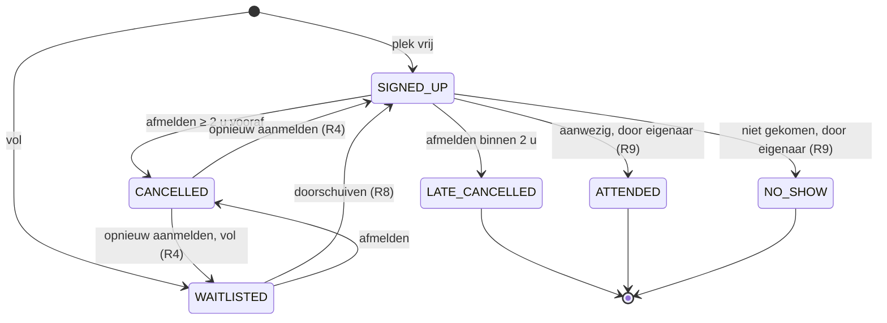

# Brul2 — Ontwerp: hulpvraag als reservering

Opgesteld: 28 oktober 2026 · Maikel

## Aanleiding en doel

Brul2 krijgt tijd in het domein: een hulpvraag wordt een tijdslot waarvoor vrijwilligers zich aanmelden, net als een reservering bij rent-my-car. Daarmee ontstaan regels die de docenten nu missen.

- **Feedback na het assessment van 27 oktober:** te weinig complexiteit, een goede start maar niet genoeg om alle competenties aan te tonen, en de reflectie op AI-tooling moet uitgebreider.
- **Wat er nu is:** vooral invoervalidatie (`require` in `init`). Echte gedragsregels zijn er maar een paar: statusovergangen, niet stemmen op je eigen melding, de aanmeldregels en de capaciteitscheck.
- **Waarom de hulpvraag:** die heeft al capaciteit en deelnemers. Met een tijdslot erbij ontstaan vanzelf overlap, deadlines, een wachtlijst en statussen die met de tijd veranderen.
- **Wat het oplevert voor P2:** regels in het domeinmodel die je zonder database test met een vaste klok, een aggregate, een state machine en transacties tegen dubbele boekingen. Bovendien geeft het de Android-app een echte functie: de agenda van een vrijwilliger.

De regels zijn verdeeld in **kern** (nodig om de feedback te beantwoorden) en **uitbreiding** (als er tijd over is). Daarnaast krijgen meldingen foto's uit de app; die regels staan in een eigen sectie.

## Domeinmodel

De regels komen in het domeinmodel: pure Kotlin zonder database en zonder klok, waarbij de tijd (`now`) een parameter is. De service haalt alleen data op, roept het model aan en slaat het resultaat op in één transactie. De routes vertalen naar HTTP.

| Klasse | Pakket | Nieuw of gewijzigd | Verantwoordelijkheid |
| --- | --- | --- | --- |
| `TimeSlot` | `report/model` | nieuw | Value object, net als `Location`: start vóór eind, overlap, gestart of afgelopen |
| `HelpRequest` | `report/model` | gewijzigd | Krijgt `slot: TimeSlot` |
| `ParticipationStatus` | `help/model` | nieuw | Zes statussen en de toegestane overgangen |
| `HelpParticipation` | `help/model` | gewijzigd | Plus `status`, `joinedAt` en `changedAt`; wordt niet meer verwijderd, alleen van status veranderd |
| `HelpRequestPhase` | `help/model` | vervangt `HelpParticipationStatus` | OPEN, FULL, IN_PROGRESS, COMPLETED, CLOSED; altijd afgeleid, nooit opgeslagen |
| `VolunteerRecord` | `help/model` | nieuw | Momentopname van een vrijwilliger: zijn slots elders en zijn recente no-shows |
| `HelpRequestBooking` | `help/model` | nieuw (aggregate) | Hulpvraag plus al zijn aanmeldingen; `join`, `leave`, `promote`, `markAttendance` |
| `JoinOutcome` | `help/model` | nieuw (sealed) | Uitkomst van aanmelden als waarde in plaats van een exception |

**TimeSlot** — let op de grens: 10:00–12:00 en 12:00–14:00 overlappen níet.

```kotlin
data class TimeSlot(val start: Instant, val end: Instant) {
    init { require(start < end) { "Start must be before end." } }

    fun overlaps(other: TimeSlot): Boolean = start < other.end && other.start < end
    fun hasStarted(now: Instant): Boolean = now >= start
    fun hasEnded(now: Instant): Boolean = now >= end
    fun timeUntilStart(now: Instant): Duration = Duration.between(now, start)
}
```

**ParticipationStatus** — de state machine zit in de enum zelf, net als `ReportStatusRules` maar dan bij het object waar hij hoort.

```kotlin
enum class ParticipationStatus {
    WAITLISTED, SIGNED_UP, CANCELLED, LATE_CANCELLED, ATTENDED, NO_SHOW;

    val isActive: Boolean get() = this == WAITLISTED || this == SIGNED_UP

    fun canMoveTo(next: ParticipationStatus): Boolean = when (this) {
        WAITLISTED -> next == SIGNED_UP || next == CANCELLED
        SIGNED_UP -> next in setOf(CANCELLED, LATE_CANCELLED, ATTENDED, NO_SHOW)
        CANCELLED -> next == SIGNED_UP || next == WAITLISTED   // opnieuw aanmelden
        LATE_CANCELLED, ATTENDED, NO_SHOW -> false            // eindstatus
    }
}
```

**HelpRequestBooking** — de aggregate: één object dat alle regels rond één hulpvraag bewaakt.

```kotlin
class HelpRequestBooking(val request: HelpRequest, val participations: List<HelpParticipation>) {

    private val signedUp get() = participations.filter { it.status == SIGNED_UP }
    val waitlist get() = participations.filter { it.status == WAITLISTED }.sortedBy { it.joinedAt }

    fun phaseAt(now: Instant): HelpRequestPhase = when {
        request.status == ReportStatus.RESOLVED -> CLOSED
        request.slot.hasEnded(now) -> COMPLETED
        request.slot.hasStarted(now) -> IN_PROGRESS
        signedUp.size >= request.volunteersNeeded -> FULL
        else -> OPEN
    }

    fun join(volunteer: VolunteerRecord, now: Instant): JoinOutcome {
        val phase = phaseAt(now)
        val existing = participations.find { it.userId == volunteer.userId }
        return when {
            request.ownerId == volunteer.userId -> Rejected(OWN_REQUEST)
            phase != OPEN && phase != FULL -> Rejected(NOT_OPEN)
            existing != null && existing.status != CANCELLED -> Rejected(ALREADY_JOINED)   // alleen na een gewone afmelding opnieuw
            volunteer.isBlocked(now) -> Rejected(BLOCKED)
            volunteer.commitments.any { it.overlaps(request.slot) } -> Rejected(TIME_CONFLICT)
            phase == FULL -> Waitlisted(position = waitlist.size + 1)
            else -> SignedUp
        }
    }
}

sealed interface JoinOutcome {
    data object SignedUp : JoinOutcome
    data class Waitlisted(val position: Int) : JoinOutcome
    data class Rejected(val reason: JoinRejection) : JoinOutcome
}
```

**VolunteerRecord** — de blokkaderegel als pure functie over een tijdvenster.

```kotlin
data class VolunteerRecord(
    val userId: Long,
    val commitments: List<TimeSlot>,   // slots van andere hulpvragen waar hij SIGNED_UP is
    val noShowTimes: List<Instant>
) {
    fun isBlocked(now: Instant): Boolean =
        noShowTimes.count { it > now.minus(Duration.ofDays(30)) } >= 3
}
```

**Service en tijd.** De service krijgt een `java.time.Clock` mee (`Clock.systemUTC()` in `Routing.kt`, `Clock.fixed(...)` in tests). Hij voert elke actie uit in één transactie via een klein `TransactionRunner`-interface; de echte versie gebruikt Exposed, de testversie roept het blok gewoon aan. Bovenaan de transactie wordt de rij van de hulpvraag vergrendeld met `forUpdate()`, zodat twee mensen niet tegelijk de laatste plek pakken. Dat gaat nu wél mis: `countByHelpRequest` en `add` lopen in aparte transacties.

## Bedrijfsregels

Tien kernregels maken van de hulpvraag een reservering; vier uitbreidingen zijn optioneel. R2 en R4 bestaan al en verhuizen naar het model. Getallen als 2 uur en 3 no-shows zijn voorstellen (zie Open beslissingen).

| Nr | Regel | Soort | Waar | Bij overtreding |
| --- | --- | --- | --- | --- |
| R1 | Een tijdslot heeft de start vóór het eind; bij aanmaken ligt de start in de toekomst | kern | `TimeSlot`, aanmaken in service | 400 |
| R2 | Je kunt je niet aanmelden voor je eigen hulpvraag | kern (bestaat) | `HelpRequestBooking.join` | 403 `OWN_REQUEST` |
| R3 | Aanmelden kan alleen in fase OPEN of FULL | kern | `join` + `phaseAt` | 409 `NOT_OPEN` |
| R4 | Geen dubbele aanmelding; na een gewone afmelding mag je opnieuw, achteraan | kern (bestaat, uitgebreid) | `join` + `canMoveTo` | 409 `ALREADY_JOINED` |
| R5 | Geen aanmelding als je in dezelfde tijd al SIGNED_UP bent bij een andere hulpvraag | kern | `join` + `TimeSlot.overlaps` | 409 `TIME_CONFLICT` |
| R6 | Is de hulpvraag vol, dan kom je op de wachtlijst, op volgorde van `joinedAt` | kern | `join` | 201 met `WAITLISTED` en positie |
| R7 | Afmelden tot 2 uur vóór de start geeft CANCELLED, daarna LATE_CANCELLED; na de start kan het niet meer | kern | `HelpRequestBooking.leave` | 409 `ALREADY_STARTED` |
| R8 | Komt vóór de start een plek vrij, dan schuift de eerste van de wachtlijst door, tenzij die een overlap heeft of geblokkeerd is; dan de volgende | kern | `HelpRequestBooking.promote` | — |
| R9 | Alleen de eigenaar zet na de start een SIGNED_UP vrijwilliger op ATTENDED of NO_SHOW | kern | `markAttendance` | 403 of 409 |
| R10 | Capaciteit kan niet lager dan het aantal SIGNED_UP; verhogen laat de wachtlijst doorschuiven (R8) | kern (bestaat, aangepast) | `ReportService.update` + `promote` | 400 |
| R11 | Met 3 no-shows in de laatste 30 dagen kun je je niet aanmelden; het venster schuift vanzelf door | uitbreiding | `VolunteerRecord.isBlocked` | 409 `BLOCKED` |
| R12 | Het tijdslot wijzigen kan alleen vóór de start en zolang niemand SIGNED_UP is | uitbreiding | `ReportService.update` | 409 |
| R13 | Sluit de eigenaar de hulpvraag vóór de start, dan worden alle actieve aanmeldingen CANCELLED (niet als laat) | uitbreiding | `HelpRequestBooking.close` | — |
| R14 | Bij een hulpvraag kan de eigenaar de status alleen op RESOLVED zetten; "bezig" volgt uit de tijd | uitbreiding | `ReportStatusRules` per type | 400 |

Als een regel overtreden wordt, geeft de API naast de bestaande `error`-tekst ook een vaste `code` terug (bijvoorbeeld `TIME_CONFLICT`). De Android-app kan daarop een eigen melding tonen in plaats van Engelse tekst te parsen.

## Statusmodellen

Een aanmelding heeft zes statussen met vaste overgangen. De fase van de hulpvraag wordt telkens afgeleid uit tijd en capaciteit.



Alleen SIGNED_UP telt als plek. Afmelden kan tot de start (R7); daarna legt alleen de eigenaar ATTENDED of NO_SHOW vast (R9). Na een gewone afmelding kun je je opnieuw aanmelden, achteraan in de rij (R4). LATE_CANCELLED, ATTENDED en NO_SHOW zijn eindstatussen.

**Fase van de hulpvraag** (`phaseAt(now)`). Van boven naar beneden; de eerste die klopt, geldt:

1. CLOSED: de eigenaar heeft de hulpvraag op RESOLVED gezet.
2. COMPLETED: het eind van het slot is voorbij.
3. IN_PROGRESS: het slot is begonnen.
4. FULL: het aantal SIGNED_UP is gelijk aan `volunteersNeeded`.
5. OPEN: in alle andere gevallen.

De fase wordt nooit opgeslagen, dus hij kan ook niet verouderen: om 10:00 is een hulpvraag vanzelf bezig, zonder achtergrondtaak.

## Database en API

Twee tabellen krijgen kolommen erbij, vier endpoints veranderen en er komen twee bij (plus één als uitbreiding). Tijden gaan als ISO-8601 in UTC over de lijn, bijvoorbeeld `"2026-11-20T10:00:00Z"`; de Android-app zet ze om naar lokale tijd.

**Database**

| Tabel | Wijziging | Toelichting |
| --- | --- | --- |
| `reports` | `slot_start`, `slot_end` (long, nullable) | Epoch-millis zoals `created_at`; alleen gevuld bij HELP_REQUEST, net als `volunteers_needed` |
| `help_participations` | `status` (varchar 20), `joined_at`, `changed_at` (long) | Rijen worden niet meer verwijderd. De unieke index op hulpvraag + gebruiker blijft: één rij per persoon, de status verandert |

`DatabaseFactory` gebruikt `SchemaUtils.create`, en dat voegt geen kolommen toe aan een bestaande tabel. Gooi daarom `data/brul.mv.db` weg en laat de seeder opnieuw draaien. De seeder moet tijdsloten maken ten opzichte van nu (bijvoorbeeld over 2 dagen), anders liggen alle demo-hulpvragen bij de volgende demo in het verleden.

**API** (onder `/api/v1`)

| Methode en pad | Nieuw of gewijzigd | Wat verandert | Regels |
| --- | --- | --- | --- |
| `POST /reports` | gewijzigd | HELP_REQUEST vereist `startsAt` en `endsAt` | R1 |
| `PUT /reports/{id}` | gewijzigd | Slot en capaciteit wijzigen met de nieuwe controles | R10, R12, R14 |
| `GET /reports/{id}/participants` | gewijzigd | Samenvatting plus `phase`, `startsAt`, `endsAt` en `waitlistCount` | R3 |
| `POST /reports/{id}/participants` | gewijzigd | 201 met `{"status":"SIGNED_UP"}` of `{"status":"WAITLISTED","position":2}`; 409 met `code` | R2–R6, R11 |
| `DELETE /reports/{id}/participants/me` | gewijzigd | Was 204; wordt 200 met de nieuwe status (CANCELLED of LATE_CANCELLED) | R7, R8 |
| `PUT /reports/{id}/participants/{userId}/attendance` | nieuw | Body `{"attended": true}`; alleen de eigenaar, alleen na de start | R9 |
| `GET /users/me/participations?upcoming=true` | nieuw | De agenda van de vrijwilliger: zijn aanmeldingen met slot en status | — |
| `GET /users/me/reliability` | nieuw (uitbreiding) | Aantal no-shows in 30 dagen, geblokkeerd ja/nee en tot wanneer | R11 |

**Wat de Android-app hieraan heeft:** een lijst open hulpvragen met tijd, aan- en afmelden met een duidelijke status, een agendascherm en foutcodes waarop de app een Nederlandse melding kan tonen. Spreek het contract vroeg in P2 af in de `.http`-demobestanden, zodat app en backend parallel kunnen.

## Foto's bij meldingen

Elke melding kan foto's krijgen die in de Android-app worden gemaakt; dit hoort bij `features/report`. Het uploaden zelf is vooral techniek. De complexiteit waar de docenten naar vragen zit in de regels over wie, wanneer en hoeveel, en in de koppeling met status en tijdslot.

**Domein**

- `ReportPhoto`: `id`, `reportId`, `uploaderId`, `kind`, `contentType`, `sizeBytes`, `storageKey`, `createdAt`.
- `PhotoKind`: SITUATION (bij het melden: wat is er aan de hand) of RESULT (na afloop: opgeruimd of geholpen).
- `PhotoPolicy`: een pure functie die met melding, uploader, bestaande foto's, upload en `now` beslist of het mag, met dezelfde aanpak als `JoinOutcome`.
- `PhotoStorage`: een interface met `save`, `load` en `delete`. De echte versie is `FileSystemPhotoStorage` (map `uploads/`, pad in de database); tests gebruiken `InMemoryPhotoStorage`. Zo blijven de bytes buiten H2 en kun je zonder schijf testen.

**Regels**

| Nr | Regel | Soort | Bij overtreding |
| --- | --- | --- | --- |
| F1 | Alleen JPEG of PNG. Controle op de eerste bytes van het bestand, niet alleen op de `Content-Type`-header | kern | 415 `UNSUPPORTED_TYPE` |
| F2 | Maximaal 5 MB per foto. Ktor stopt met lezen bij de limiet via `receiveMultipart(formFieldLimit = …)`, niet pas achteraf | kern | 413 `TOO_LARGE` |
| F3 | Maximaal 3 foto's per melding | kern | 409 `PHOTO_LIMIT` |
| F4 | Een SITUATION-foto plaatst alleen de eigenaar, en alleen zolang de melding niet RESOLVED is | kern | 403 of 409 |
| F5 | Een RESULT-foto bij een hulpvraag plaatst alleen een vrijwilliger met SIGNED_UP of ATTENDED, en pas vanaf de start van het slot | kern | 403 of 409 `NOT_STARTED` |
| F6 | GPS- en andere EXIF-gegevens worden bij upload verwijderd door de afbeelding opnieuw te encoderen. De melding heeft al een locatie; de foto hoeft niet ook te verraden waar de maker woont | kern | — |
| F7 | Verwijderen mag de uploader of een admin. Wordt de melding verwijderd, dan ruimt de service ook de bestanden op; de cascade in de database verwijdert alleen de rijen | kern | 403 |
| F8 | Een overlastmelding kan pas op RESOLVED als er een RESULT-foto is | uitbreiding | 409 `RESULT_PHOTO_REQUIRED` |

Let op bij F6: met de EXIF-gegevens verdwijnt ook de draai-informatie, dus een telefoonfoto kan op zijn kant komen te staan. Laat de app de foto daarom vóór upload rechtop zetten en verkleinen, bijvoorbeeld tot maximaal 1600 pixels. Dat houdt bestanden ook ruim onder de 5 MB.

**Database en API**

Nieuwe tabel `report_photos`: `id`, `report_id` (cascade), `uploader_id`, `kind`, `content_type`, `size_bytes`, `storage_key`, `created_at`.

| Methode en pad | Wat | Regels |
| --- | --- | --- |
| `POST /reports/{id}/photos` | Multipart met de velden `kind` en `photo`; 201 met de gegevens en een `url` | F1–F6 |
| `GET /reports/{id}/photos` | Lijst met foto-gegevens en URL's | — |
| `GET /photos/{photoId}` | De afbeelding zelf, met de juiste `Content-Type` | — |
| `DELETE /photos/{photoId}` | Foto verwijderen | F7 |
| `GET /reports/{id}` | Antwoord krijgt `photoCount` | — |

**Besloten:** foto's zijn voor iedereen zichtbaar, net als de meldingen zelf. `GET /reports/{id}/photos` en `GET /photos/{photoId}` werken dus zonder login; uploaden en verwijderen vereisen wel een JWT. Omdat de foto's openbaar zijn, is F6 extra belangrijk.

**Tests**

| Nr | Regel | Gegeven | Wanneer | Dan | Soort |
| --- | --- | --- | --- | --- | --- |
| P1 | F1 | Bytes van een PDF met header `image/jpeg` | Upload | `UNSUPPORTED_TYPE` | unit |
| P2 | F3 | Melding heeft al 3 foto's | Vierde upload | `PHOTO_LIMIT` | unit |
| P3 | F5 | Vrijwilliger is SIGNED_UP bij H; nu 09:00, daarna 10:30 | RESULT-foto | `NOT_STARTED`; toegestaan | unit |
| P4 | F6 | JPEG met GPS-gegevens | Opslaan | Opgeslagen bestand bevat geen EXIF-blok | unit |
| P5 | F2 | Bestand van 6 MB | `POST /reports/{id}/photos` | 413; niets opgeslagen | integratie |
| P6 | F7 | Melding met 2 foto's in `InMemoryPhotoStorage` | `DELETE /reports/{id}` | Beide bestanden weg uit de opslag | integratie |

Dit pakket is van Maikel. Om de last te verdelen gaan R12 en R14 naar Phuc (zie Taakverdeling).

## Testscenario's

De kernregels zijn te testen als gewone objecttests, zonder database. Dat is een duidelijk verschil met de huidige `HelpParticipationServiceTest`, die voor elke test een H2-database opbouwt. Alle scenario's gebruiken een vaste klok en dezelfde uitgangssituatie: **nu = 20 november 2026, 08:00 UTC; hulpvraag H heeft slot 10:00–12:00 en 2 plekken.**

| Nr | Regel | Gegeven | Wanneer | Dan | Soort |
| --- | --- | --- | --- | --- | --- |
| T1 | R1 | Slot 12:00–10:00 | Aanmaken | `IllegalArgumentException` | unit |
| T2 | R5 | Slots 10–12 en 12–14; 10–12 en 11–13 | `overlaps` | Eerste paar `false` (grens), tweede `true` | unit |
| T3 | R3 | Nu = 10:30 | Aanmelden bij H | `Rejected(NOT_OPEN)` | unit |
| T4 | R5 | Vrijwilliger is SIGNED_UP bij G (11:00–13:00) | Aanmelden bij H | `Rejected(TIME_CONFLICT)` | unit |
| T5 | R6 | H heeft 2 SIGNED_UP | Twee nieuwe aanmeldingen | `Waitlisted(1)`, daarna `Waitlisted(2)` | unit |
| T6 | R7 | Vrijwilliger is SIGNED_UP | Afmelden om 08:00, om 08:30 en om 10:00 | CANCELLED (precies 2 uur telt nog), LATE_CANCELLED, `ALREADY_STARTED` | unit |
| T7 | R8 | Wachtlijst: A (overlap elders), dan B | Een SIGNED_UP meldt zich af | B wordt SIGNED_UP, A blijft WAITLISTED | unit |
| T8 | R9 | Vrijwilliger is SIGNED_UP | Eigenaar markeert om 09:59; om 12:30; een ander om 12:30 | 409; ATTENDED; 403 | unit |
| T9 | R11 | No-shows 29, 10 en 1 dag geleden; en 31, 10 en 1 dag geleden | `isBlocked` | `true`; `false` | unit |
| T10 | R4 | Eerst CANCELLED; ander geval LATE_CANCELLED | Opnieuw aanmelden | SIGNED_UP met nieuwe `joinedAt`; `Rejected(ALREADY_JOINED)` | unit |
| T11 | R6, R8 | Via de API: H vol, C staat op de wachtlijst | `DELETE /participants/me` door een deelnemer | 200 CANCELLED; samenvatting toont C als deelnemer, `waitlistCount` 0 | integratie |
| T12 | R5 | Via de API: overlap zoals T4 | `POST /participants` | 409 met `"code":"TIME_CONFLICT"` | integratie |
| T13 | R9 | Via de API | Attendance zonder JWT; door niet-eigenaar | 401; 403 | integratie |
| T14 | R6 | Eén plek vrij | Twee gelijktijdige aanmeldingen (twee threads) | Precies één SIGNED_UP en één WAITLISTED | integratie |
| T15 | — | Exposed-repository | Aanmelding opslaan en teruglezen | Status, `joinedAt` en `changedAt` blijven gelijk | repository |

T14 is de lastigste en tegelijk de beste om op het assessment te laten zien: hij faalt zonder `forUpdate()` en slaagt ermee. Bestaande tests moeten mee: de constructor van `HelpParticipation` verandert en afmelden geeft voortaan 200 in plaats van 204.

## Taakverdeling

Iedereen houdt zijn eigen feature en krijgt minstens één regel met echte logica om op het assessment uit te leggen. Het is een voorstel; schuif gerust.

| Wie | Pakket | Regels | Tests | Kan starten |
| --- | --- | --- | --- | --- |
| Maikel (report) | `TimeSlot`; slot op `HelpRequest`, `NewReport`, DTO's en mapper; kolommen in `reports`; seeder met tijden ten opzichte van nu; foto's bij meldingen | R1, R10, F1–F8 | T1, T2, P1–P6 | Direct |
| Kelvin (help) | `ParticipationStatus`, `HelpParticipation`, `HelpRequestBooking` (`join`, `leave`, `promote`, `phaseAt`); service met `Clock`, `TransactionRunner` en `forUpdate()`; endpoints aanmelden, afmelden en samenvatting | R2–R8 | T3–T7, T10, T11, T14, T15 | Direct met het model; na stap 1 met het echte slot |
| Joselyn (vote) | Aanwezigheid registreren en betrouwbaarheid: `markAttendance`, `VolunteerRecord.isBlocked`, sluiten met annuleren; attendance-endpoint | R9, R11, R13 | T8, T9 | Na `ParticipationStatus` |
| Natasja (user) | `GET /users/me/participations` (agenda) en `/reliability`; de query die een `VolunteerRecord` vult (slots elders + no-shows) | — (levert data voor R5 en R11) | Integratietest agenda | Na de tabelwijziging |
| Phuc (auth) | Foutcontract met `code` in `ErrorHandling`; `JoinRejection` naar HTTP; autorisatie op de nieuwe endpoints; `.http`-bestanden als API-contract voor de app | R12, R14; bewaakt R2 en R9 op HTTP | T12, T13 | Direct |

**Volgorde**

1. Maikel levert `TimeSlot` en Phuc het API-contract met foutcodes. Kelvin begint parallel aan de state machine en `HelpRequestBooking`.
2. Kelvin bouwt de service met transactie; Maikel de foto's; Joselyn de aanwezigheid; Natasja de agenda en het vullen van `VolunteerRecord`.
3. Samen: integratietests T11–T14, de seeder, de `.http`-demo, en de app aansluiten op het contract.

Iedereen houdt tijdens het bouwen het AI-logboek bij (volgende sectie).

## Open beslissingen en AI-logboek

Deze punten beslist de groep vóór stap 2. De voorstellen staan erbij.

- [ ] Assessment-route: meenemen in het P2-assessment of een aparte tweede kans halverwege P2? Doorgeven bij de start van P2.
- [ ] Afmeldtermijn voor een gewone afmelding: 2 uur vóór de start?
- [ ] Blokkade: 3 no-shows in 30 dagen? Telt een late afmelding mee, bijvoorbeeld als halve?
- [ ] Maximale duur van een tijdslot (voorstel: 8 uur)?
- [ ] Opnieuw aanmelden na een late afmelding: verbieden (voorstel) of toestaan?
- [ ] Mag je op de wachtlijst van twee overlappende hulpvragen staan? Voorstel: ja, want de overlap wordt bij het doorschuiven gecontroleerd (R8).
- [ ] Opruimen vóór het volgende assessment: `docs/01-vastgestelde-ontwerpkeuzes.md` gaat over PocketBattleAPI, `help/model/aaa.md` is een kopie van het draaiboek, en de slides noemen ~35 tests terwijl het draaiboek 268 zegt.
- [ ] Aan Eric vragen welke vorm hij voor de AI-reflectie wil: een logboek, een reflectieverslag of beide.

**AI-logboek.** De slide met AI-verantwoording heeft nu drie punten. Houd per keer dat een AI-tool echt iets bijdraagt een regel bij: wat je vroeg, wat eruit kwam, wat je veranderde of afkeurde, en hoe je het controleerde. Dit ontwerp is zelf ook met AI gemaakt (Claude, op basis van de Brul2-code), dus dat is meteen de eerste regel.

| Datum | Wie | Tool | Waarvoor | Wat het opleverde | Wat we veranderden of afkeurden | Hoe gecontroleerd |
| --- | --- | --- | --- | --- | --- | --- |
| 28-10-2026 | Maikel | Claude | Ontwerp voor complexere domeinlogica na de feedback | Dit document: regels, klassen, tests en taakverdeling | | |
| | | Gemini / Antigravity | Kotlin-code (voorbeeld uit de slides) | Code met `String.format`, een Java-patroon | Herschreven naar Kotlin-syntax | Unittests |
| | | | | | | |
