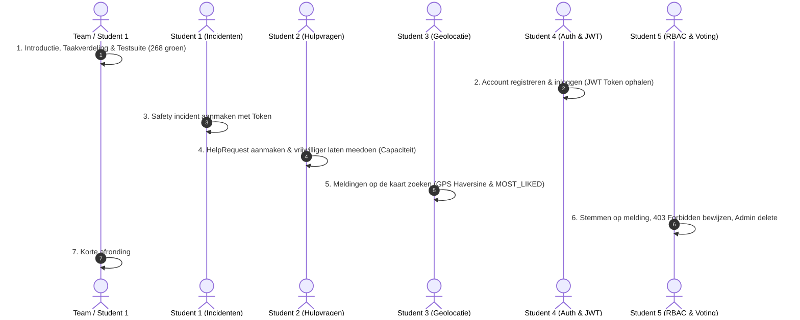

# Brul2 — Demo Draaiboek & Video Script

> **Doel:** Beoordeling van de gerealiseerde REST API aan de hand van user flows in IntelliJ HTTP Requests, toelichting van de taakverdeling (5 studenten) en demonstratie van unit- en integratietesten.  
> **Geschatte tijdsduur:** 6 à 8 minuten (strak en to-the-point).  
> **Status applicatie:** 268 tests groen, 0 failures.

---

## 1. Overzicht Taak- & Rolverdeling (5 Verticale Features)

In plaats van een horizontale opsplitsing (waarbij iemand alleen de database of alleen de routes doet), heeft iedere student een **complete verticale feature (full-stack backend)** gerealiseerd: van domeinmodel (OOP) en database-tabel (Exposed) tot servicelogica (FP), Ktor routes en unit-/integratietesten.

| Student | Feature / Onderdeel | Kernconcepten | Te tonen Code / Test | Te demonstreren User Flow |
|---|---|---|---|---|
| **Gezamenlijk / Student 1** | **De Gezamenlijke Basis** | Clean Architecture, Ktor StatusPages, DatabaseFactory, Abstract Report | `ErrorHandling.kt`<br>`DatabaseFactory.kt` | `kotlin test` (268 tests groen!) & `GET /health` |
| **Student 1** | **Incidentenbeheer (Safety & Nuisance)** | **OOP:** Abstraction, Inheritance, Encapsulation, Category Validation | `SafetyReport.kt`<br>`ReportModelTest.kt` | Incident aanmaken (`POST /reports`), ophalen op ID |
| **Student 2** | **Hulpvragen & Vrijwilligers (Participation)** | **State & Capaciteit:** Vrijwilligers matching, Status transitions, Guards | `HelpParticipationService.kt`<br>`HelpParticipationServiceTest.kt` | Hulpvraag publiceren, vrijwilliger aanmelden (`join`), capaciteit bewaken |
| **Student 3** | **Geolocatie & Discovery (Search & Sort)** | **FP & Math:** Haversine formula, Lambdas, `MOST_LIKED` & `NEAREST` sorting | `Location.kt`<br>`ReportSearch.kt`<br>`ReportSearchTest.kt` | Zoeken op GPS-straal (5 km) en sorteren op populariteit (`MOST_LIKED`) |
| **Student 4** | **Identity, Hashing & Authenticatie** | **Security & Auth:** BCrypt password salting, JWT signing, Ktor Auth | `BCryptPasswordHasher.kt`<br>`JwtService.kt`<br>`JwtServiceTest.kt` | Registreren, inloggen, JWT bearer token ontvangen, profiel opvragen (`/me`) |
| **Student 5** | **Autorisatie (RBAC) & Community Voting** | **Security & Access Control:** Eigenaarschap, User vs. Admin, Voting | `VoteRoutes.kt`<br>`ReportAdminAuthenticationFlowTest.kt` | Stemmen op melding (`PUT /vote`), **403 Forbidden** aantonen, Admin delete |

---

## 2. Het Video Draaiboek (Stap-voor-stap)



---

### Blok 0: Introductie, Taakverdeling & De Gezamenlijke Basis (± 1 minuut)
*Wie presenteert:* **Student 1 (of gezamenlijk als team)**

#### Wat je vertelt:
> *"Welkom bij de demo van Brul2, onze REST API voor buurtpreventie en burenhulp, gebouwd met Kotlin, Ktor, JetBrains Exposed en H2. We zijn met een team van 5 studenten. Om te zorgen dat iedereen de volledige breedte van softwareontwikkeling leert, hebben we gekozen voor verticale feature-slicing. Iedere student heeft een complete feature gebouwd van domeinmodel en database tot route en testen.*
>
> *Voordat we onze features bouwden, hebben we eerst een gemeenschappelijke basis neergezet: centrale JSON-serialisatie, een centrale H2 database factory en centrale foutafhandeling via Ktor StatusPages. Hierdoor levert elke fout in de applicatie uniform een gestandaardiseerde ApiError JSON op."*

#### Wat je in beeld laat zien & aanklikt:
1. **Draai de testsuite live:** Run in de terminal `.\kotlin.bat test` (of in IntelliJ):
    * Laat zien: **`268 tests successful, 0 failed`**.
    * Noem: *"We hebben 268 geautomatiseerde unit- en integratietests die continu onze regressie bewaken."*
2. **IntelliJ HTTP Client:** Klik op request `GET /api/v1/health` $\rightarrow$ Toont `200 OK` met `{"status": "ok", "service": "brul-api"}`.

---

### Blok 1: Student 4 — Identity, Password Hashing & Authenticatie (± 1.5 minuut)
*We laten Student 4 als eerste zijn/haar feature demonstreren, omdat de andere studenten zijn/haar JWT tokens nodig hebben voor beveiligde acties.*

#### Wat je vertelt:
> *"Ik heb de authenticatie- en gebruikersfeature gerealiseerd. Wachtwoorden worden nooit in platte tekst bewaard: ik gebruik BCrypt met een veilige salt. Bij een succesvolle login genereert mijn JwtService een HMAC-SHA256 ondertekend token waarin het gebruikers-ID en de rol zijn vastgelegd. Ktor valideert dit token vervolgens via de Authentication plugin."*

#### Wat je in beeld laat zien & aanklikt:
1. **Code & Test:**
    * Open kort `BCryptPasswordHasher.kt` en `JwtService.kt`.
    * Toon de test `BCryptPasswordHasherTest.kt` of `JwtServiceTest.kt` (groen).
2. **HTTP Requests (in IntelliJ):**
    * **Stap 1: Registreren:**  
      `POST /api/v1/auth/register`  
      *Body:* `{"username": "anastasia", "email": "anastasia@example.com", "password": "Password123!"}`  
      *Resultaat:* `201 Created` (zonder wachtwoord in response!).
    * **Stap 2: Inloggen:**  
      `POST /api/v1/auth/login`  
      *Resultaat:* `200 OK` met het JWT `accessToken`.
    * **Stap 3: Profiel ophalen:**  
      `GET /api/v1/auth/me` met `Authorization: Bearer <token>`  
      *Resultaat:* `200 OK` met gebruikersgegevens. (Laat zien dat zonder token een `401 Unauthorized` volgt!).

---

### Blok 2: Student 1 — Incidentenbeheer & OOP Domein (Safety & Nuisance) (± 1.5 minuut)

#### Wat je vertelt:
> *"Ik heb de feature voor fysieke incidenten (veiligheid en overlast) ontwikkeld. Hierin pas ik nadrukkelijk Object-Oriented Programming (OOP) toe: een abstracte klasse Report met polymorfe subclasses SafetyReport en NuisanceReport. Ieder type dwingt zijn eigen domeinregels en toegestane categorieën af. Deze meldingen worden via Exposed opgeslagen in de ReportsTable."*

#### Wat je in beeld laat zien & aanklikt:
1. **Code & Test:**
    * Open `SafetyReport.kt` (laat de overerving van `Report` en de category validatie zien).
    * Toon `ReportModelTest.kt`: laat zien hoe een ongeldige categorie voor een SafetyReport direct een exceptie oplevert.
2. **HTTP Requests (in IntelliJ):**
    * **Stap 1: Melding aanmaken:**  
      `POST /api/v1/reports` (met Bearer token van Anastasia)  
      *Body:*
      ```json
      {
        "type": "SAFETY",
        "title": "Verdachte situatie bij fietsenstalling",
        "description": "Twee personen kijken verdacht naar scooters",
        "category": "SUSPICIOUS_SITUATION",
        "latitude": 51.585,
        "longitude": 4.775,
        "urgent": true
      }
      ```
      *Resultaat:* `201 Created` met een gegenereerd ID (bijv. ID 1) en `ownerId`.
    * **Stap 2: Melding opvragen:**  
      `GET /api/v1/reports/1`  
      *Resultaat:* `200 OK` met de volledige melding.

---

### Blok 3: Student 2 — Hulpvragen & Vrijwilligersparticipatie (± 1.5 minuut)

#### Wat je vertelt:
> *"Ik heb de hulpvragen- en vrijwilligersfeature gebouwd. Dit breidt Report uit naar HelpRequest met een benodigd aantal vrijwilligers. Daarnaast heb ik het participatiesysteem gerealiseerd. Mijn service bewaakt de capaciteit: als het maximum aantal vrijwilligers is bereikt, verandert de status automatisch naar FULL. Ook voorkom ik dat iemand twee keer meedoet of dat de maker zichzelf als vrijwilliger aanmeldt."*

#### Wat je in beeld laat zien & aanklikt:
1. **Code & Test:**
    * Open `HelpParticipationService.kt` en `HelpParticipationsTable.kt`.
    * Toon `HelpParticipationServiceTest.kt` (bijv. test `help request becomes full when capacity is reached`).
2. **HTTP Requests (in IntelliJ):**
    * **Stap 1: Hulpvraag aanmaken:**  
      `POST /api/v1/reports`  
      *Body:*
      ```json
      {
        "type": "HELP_REQUEST",
        "title": "Hulp gezocht bij zware boodschappen",
        "description": "Wie kan morgenmiddag even helpen sjouwen?",
        "category": "GROCERIES",
        "latitude": 51.582,
        "longitude": 4.771,
        "volunteersNeeded": 1
      }
      ```
      *Resultaat:* `201 Created` (Status: `OPEN`, ID: bijv. 2).
    * **Stap 2: Aanmelden als vrijwilliger:**  
      Log in als een 2e gebruiker (`POST /reports/2/participants` met Bearer token).  
      *Resultaat:* `201 Created`.
    * **Stap 3: Samenvatting inzien:**  
      `GET /api/v1/reports/2/participants`  
      *Resultaat:* `200 OK` $\rightarrow$ `volunteersNeeded: 1`, `participantCount: 1`, `status: FULL`!

---

### Blok 4: Student 3 — Geolocatie, Discovery & Sorteren (FP) (± 1.5 minuut)

#### Wat je vertelt:
> *"Mijn feature zorgt ervoor dat buurtbewoners meldingen kunnen ontdekken op basis van geolocatie en criteria. Hier heb ik Functional Programming (FP) toegepast: met de Haversine formule bereken ik de exacte afstand over de aardbol tussen coördinaten. Met hogere-orde functies zoals filter, sortedWith en compareBy ondersteun ik filteren op straal en sorteren op ID, nieuwste, afstand (NEAREST) én populariteit (MOST_LIKED)."*

#### Wat je in beeld laat zien & aanklikt:
1. **Code & Test:**
    * Open `Location.kt` (toon de `distanceTo` wiskundige formule) en `ReportSearch.kt`.
    * Toon `ReportSearchTest.kt` (toon dat de afstandsberekening en filters groen testen).
2. **HTTP Requests (in IntelliJ):**
    * **Stap 1: Zoeken op afstand (GPS-coördinaten + 2 km straal):**  
      `GET /api/v1/reports?latitude=51.58&longitude=4.77&radiusKm=2&sort=NEAREST`  
      *Resultaat:* `200 OK` met gesorteerde lijst op afstand.
    * **Stap 2: Sorteren op populariteit:**  
      `GET /api/v1/reports?sort=MOST_LIKED`  
      *Resultaat:* `200 OK` (toont meldingen met de meeste upvotes bovenaan).

---

### Blok 5: Student 5 — Autorisatie (RBAC) & Community Voting (± 1.5 minuut)

#### Wat je vertelt:
> *"Ik heb de autorisatie- en community voting-feature gebouwd. Waar Student 4 authenticatie regelt (wie ben je), bewaak ik autorisatie (wat mag je). Ik handhaaf eigenaarschap via JWT role claims: een gewone gebruiker mag alleen zijn eigen melding updaten. Andermans melding aanpassen levert een 403 Forbidden op. Beheerders met de ADMIN-rol mogen daarentegen wel ongepaste meldingen verwijderen. Daarnaast heb ik het upvote/downvote systeem gebouwd inclusief controle tegen dubbel stemmen en cascade-delete in de database."*

#### Wat je in beeld laat zien & aanklikt:
1. **Code & Test:**
    * Open `VoteRoutes.kt` en `ReportRoutes.kt` (laat de ownership en ADMIN check zien).
    * Toon `ReportAdminAuthenticationFlowTest.kt` of `VoteCascadeDeleteTest.kt`.
2. **HTTP Requests (in IntelliJ):**
    * **Stap 1: Upvoten op een melding:**  
      `PUT /api/v1/reports/1/vote` met `{"type": "LIKE"}`  
      *Resultaat:* `201 Created` (stem opgeslagen).
    * **Stap 2: Autorisatie afdwingen (De 'Unhappy' flow):**  
      Probeer als Gebruiker B de melding van Gebruiker A aan te passen:  
      `PUT /api/v1/reports/1`  
      *Resultaat:* **`403 Forbidden`**! (Benadruk dit: *"Hier bewijzen we dat autorisatie echt werkt!"*).
    * **Stap 3: Admin overrule:**  
      Log in als beheerder (`admin@example.com` met claim `role: ADMIN`) en verwijder de melding:  
      `DELETE /api/v1/reports/1`  
      *Resultaat:* **`204 No Content`**!

---

### Blok 6: Afronding & Conclusie (± 30 seconden)
*Wie presenteert:* **Het hele team / Student 1**

#### Wat je vertelt:
> *"Hiermee hebben we aangetoond dat onze Brul2 REST API volledig functioneert: 5 verticale features, gebouwd op een solide gezamenlijke basis, 268 geslaagde tests, en een duidelijke demonstratie van OOP, functioneel programmeren, databasepersistentie en beveiliging via authenticatie en autorisatie. Bedankt voor het kijken!"*

---

## 3. Checklist voor de Opname

- [ ] **Kloon schone stand:** Zorg voor een lege of bekende database zodat ID's voorspelbaar zijn (1, 2, etc.).
- [ ] **Requests klaarzetten:** Plaats het bestand `requests.http` in de root van IntelliJ.
- [ ] **Microfoons testen:** Zorg dat iedereen goed verstaanbaar is.
- [ ] **Resolutie:** Schermopname op 1080p (Full HD) met een goed leesbare lettergrootte in IntelliJ (`Settings -> Appearance -> Zoom: 110% of 125%`).
- [ ] **Geen knip-en-plak fouten:** Gebruik IntelliJ's `client.global.set("token", ...)` in het HTTP-bestand zodat tokens automatisch worden doorgestuurd!
